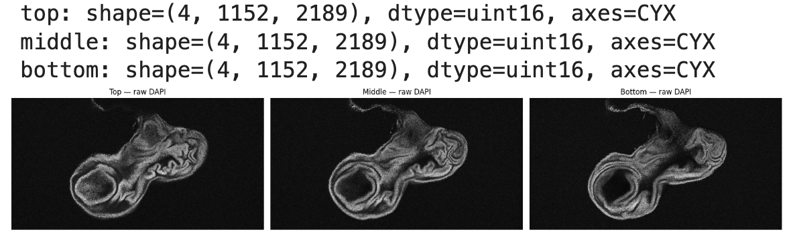

# Quantitative Tissue Phenotyping

Author and pipeline lead: Yang Cheng, University of Virginia (UVA), Christopher Deppmann and Melanie Worley laboratories.

Developed with assistance from ChatGPT (OpenAI) in coding, documentation and tutorial preparation.

Quantitative Tissue Phenotyping connects segmentation masks, per-object marker measurements and anatomical regions to characterize tissue phenotypes at single-cell resolution. It can be used with tissue immunofluorescence, fluorescence-based immunohistochemistry and HCR images when the images contain a suitable nuclear marker and aligned marker channels. A Drosophila wing disc with an ectopic structure serves as the worked example.

## Applications and scope

The same image-and-mask workflow can quantify fluorescence from antibody staining or HCR within segmented nuclei or suitable whole-cell masks, then compare marker-positive populations across anatomical regions. The supplied example measures nuclear mean intensity; HCR puncta counting and transcript assignment would require additional analysis. Chromogenic immunohistochemistry would require stain-specific image preprocessing and validation before using the measurement workflow.

The region selection, gating and spatial visualization could potentially be adapted for spatial-omics data with compatible per-cell measurements and registered spatial coordinates. Such an adaptation would require a data importer, appropriate normalization and validation for that assay. The current worked example demonstrates the workflow on wing-disc fluorescence images; it does not demonstrate a spatial-omics analysis.

## Why this pipeline is useful

Tissue immunofluorescence images are often interpreted through qualitative observations of morphology and marker expression. Those observations reveal where a phenotype occurs, but systematic comparisons also require cell counts, marker measurements and a consistent definition of the anatomical region being compared. This pipeline provides a practical way to obtain those measurements while keeping each object linked to its position in the tissue.

For example, it lets users ask: How many cells are GFP-positive in the original pouch, and how many are GFP-positive in the ectopic pouch? What fraction of the cells in each region passes the same GFP threshold? How does the distribution of GFP intensity differ between those regions?

## What the pipeline measures

1. Segment individual nuclei using a nuclear marker such as DAPI. A nuclear channel is sufficient input for the nuclear-only workflow; additional marker channels can then be quantified within those masks.
2. Measure the mean raw fluorescence intensity of every marker channel within each segmented nucleus, producing a table of marker abundance estimates for individual objects. With suitable whole-cell masks, the same measurement principle applies to cells. Fluorescence intensity is a relative readout of marker abundance within the measured compartment, rather than an absolute molecule count.
3. Define anatomical regions by freehand drawing, count the segmented objects within each region, and retain their individual marker measurements. Marker thresholds identify positive populations and support regional counts and percentages, such as GFP-positive nuclei in the original versus ectopic pouch.

The intended output is a set of quantitative phenotype descriptions: where marker-enriched cells are located, how many occur in each region, and how strongly individual nuclei or cells express the measured markers. Segmentation and gate choices should be checked against the images before interpreting these measurements.

## Nuclear and whole-cell segmentation

In the supplied dataset, all four channels label nuclear signals: C1 GFP, C2 unidentified marker, C3 DAPI and C4 RFP. We therefore used DAPI alone as the segmentation input and measured all four raw channels within the resulting nuclear masks. In this example, a counted object is a segmented nucleus; no whole-cell boundary is inferred from these nuclear channels.

With a nuclear marker plus a suitable membrane or cytoplasmic marker, an appropriate DeepCell application such as Mesmer can produce nuclear and whole-cell segmentations, allowing marker measurements in each compartment. The quality of the additional boundary signal and performance on the tissue must be checked. This capability is described in the [DeepCell Mesmer documentation](https://deepcell.readthedocs.io/en/master/app-gallery/mesmer.html) and the [Mesmer methods paper](https://pmc.ncbi.nlm.nih.gov/articles/PMC9010346/). Whole-cell segmentation code is outside this nuclear-only worked example.

The recorded analysis applied a pretrained DeepCell nuclear model and tuned preprocessing, input scale and filtering. It did not train a new model on annotated wing-disc images.

## Start with the original image stack

The source image, ectopic disc 2 (pdm2), is a four-channel Z-stack with 52 slices per channel. The embedded acquisition metadata records a 10× objective, specifically Plan-Apochromat 10x/0.45 M27, and a 2 µm interval between adjacent Z-slices. Each slice is 2189 × 1152 pixels, with an XY pixel size of approximately 0.5546 µm.

The goal of plane selection is to sample representative tissue depths without collapsing the entire disc into one projection. We first chose a central tissue view that includes the intact wing disc and the ectopic structure, then selected equally spaced views above and below it. Here, “middle” refers to that anatomically selected reference view, rather than necessarily the numerical midpoint of the acquired stack.

## Prepare three representative projections in FIJI

1. Open the original four-channel stack in FIJI and inspect the Z-slices. Identify a central reference view that captures the intact wing disc and ectopic structure while allowing individual nuclei to be resolved.
2. Make a maximum-intensity projection of the two adjacent slices chosen for that reference view. For this example, the middle projection uses Z33–Z34, with slice numbers counted from 1.
3. Select matching two-slice ranges at equal distances above and below the middle pair. This example uses Z28–Z29 for the top projection and Z38–Z39 for the bottom projection. Corresponding slices in neighboring pairs differ by five Z-steps, or 10 µm; the projection-pair midpoints are therefore also 10 µm apart.
4. For each range, use Image > Stacks > Z Project in FIJI, set the start and stop slices, and choose Max Intensity. Apply the same slice range separately across all four channels, retaining a four-channel image rather than an RGB composite. Save each result as a separate TIFF with C = 4 and Z = 1, preserving the original bit depth and XY calibration.

Each projection combines two adjacent slices sampled 2 µm apart. The result is three representative 2D views of this disc, not a 3D reconstruction. Use the same number of adjacent slices for all three projections and record their exact slice ranges. Select suitable reference depths for each new specimen rather than copying these numerical ranges automatically.

The example above shows the top, middle and bottom DAPI projections from slide 2 of the supplied presentation. The three views use Z28–Z29, Z33–Z34 and Z38–Z39, respectively. Each saved image also retains GFP, C2 and RFP as separate channels.

## Preserve raw intensities for quantification

Brightness and contrast changes are unnecessary for measurement. FIJI display adjustments may help visual inspection, provided they do not alter the pixel values used for quantification. Do not apply contrast rescaling to the analysis images, convert them to 8-bit or RGB, or replace their marker channels with enhanced images.

DAPI core enhancement is a separate processing step used to prepare the segmentation input. Once masks are available, all marker means are calculated from the unenhanced projected channels. Each projected pixel is the maximum of its two source slices in that channel, so “raw” here means the unmodified intensity of the saved maximum projection. Different channels can obtain their maxima from different source slices.

The three representative projections were segmented independently using DAPI, then used for marker measurement and regional phenotyping. The example contains 6,847 top-plane masks, 7,253 middle-plane masks and 7,380 bottom-plane masks. There is no cross-plane matching: the total of 21,480 plane-specific masks should not be interpreted as 21,480 unique cells throughout the disc.

## Follow the worked example

The next section documents segmentation in the original UVA DeepCell environment. Users with existing masks can skip to Installation and example files. The locally runnable measurement tutorial starts with the saved segmentation labels. It includes a small real four-channel TIFF crop with 416 complete nuclear masks and the full measurement table for all three planes. Follow the code blocks to measure raw intensities, select nuclei with marker gates, inspect their locations, define regions and export regional summaries.

Download the complete tutorial bundle to keep the code, notebook and example data together. The original DeepCell segmentation ran on HPC; its saved labels let you follow the measurement and phenotyping steps without an HPC account. Images and recorded results are displayed on this page, while the analysis itself runs in Python or the matching notebook.
